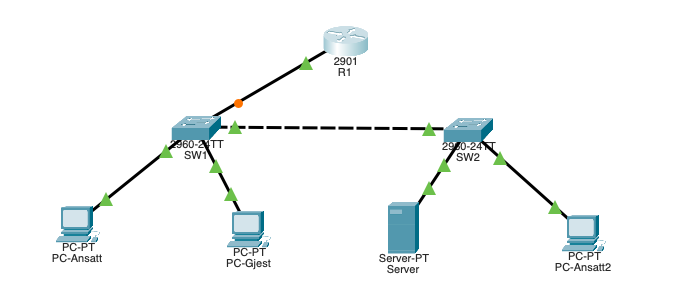
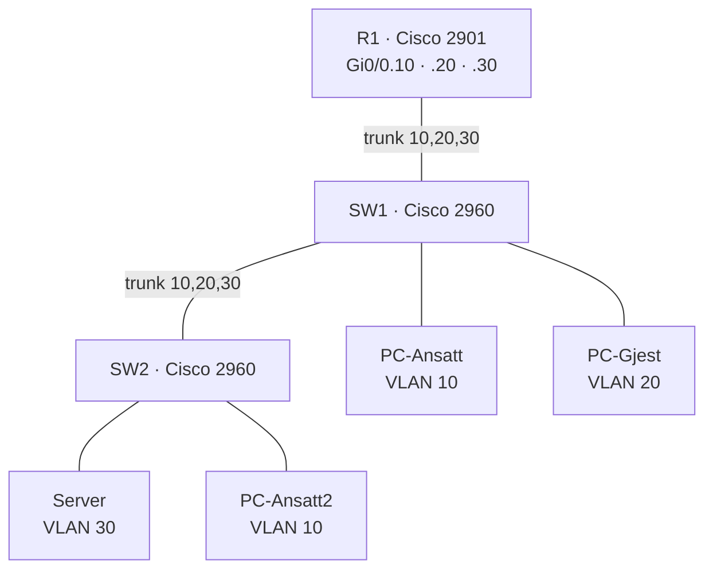
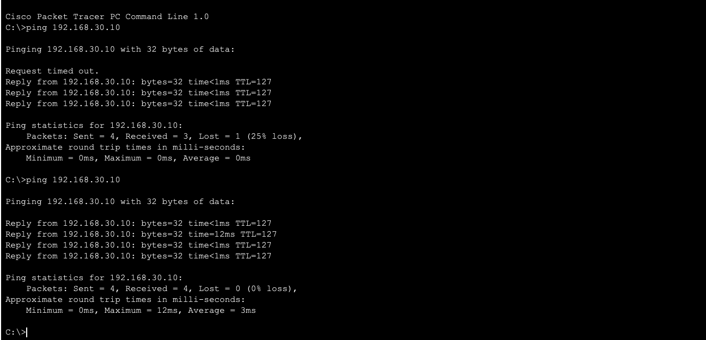
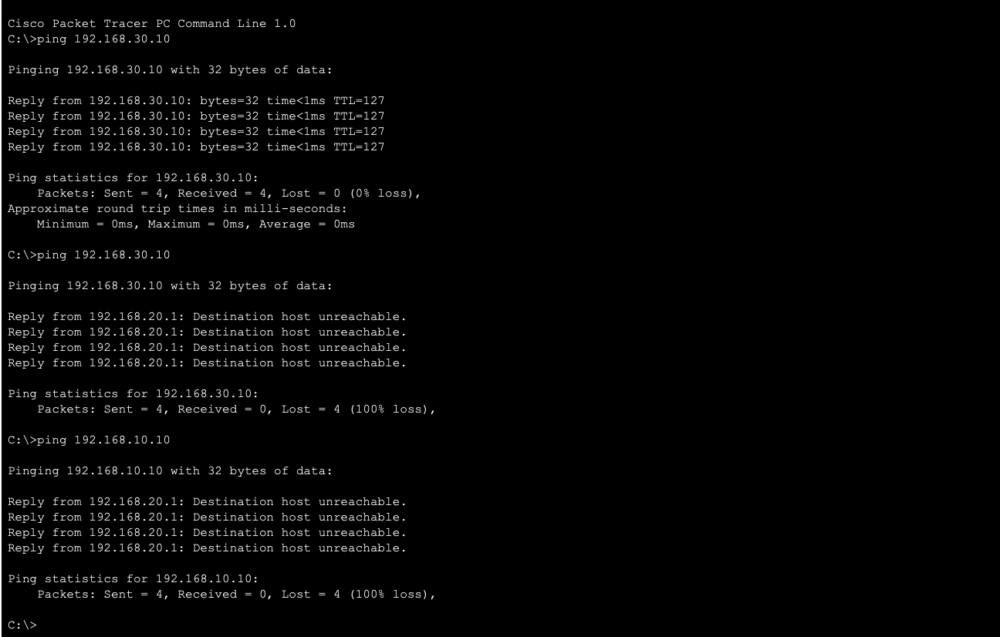
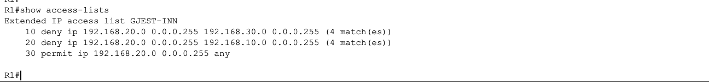

# Office network with VLANs, inter-VLAN routing and a guest ACL

> 🇳🇴 **Kort på norsk:** Et lite kontornett i Cisco Packet Tracer: tre VLAN (ansatte, gjester, servere), trunk mellom to svitsjer, ruting mellom VLAN på én ruter (router-on-a-stick) og en ACL som gir gjester tilgang til internett, men ikke til servere eller ansatte.

A segmented office network built in Cisco Packet Tracer 9.0.1. Staff, guests and servers live in separate VLANs. A single router routes between them, and an extended ACL keeps guest devices away from internal systems while still allowing them out.

**Skills shown:** VLANs and 802.1Q trunking · inter-VLAN routing (router-on-a-stick) · extended ACLs and wildcard masks · Cisco IOS CLI · network segmentation · verification with `ping` and `show` commands

## Topology





## Addressing

| VLAN | Name | Network | Gateway (R1) | Host |
|---|---|---|---|---|
| 10 | Ansatte (staff) | 192.168.10.0/24 | 192.168.10.1 | PC-Ansatt .10, PC-Ansatt2 .11 |
| 20 | Gjest (guests) | 192.168.20.0/24 | 192.168.20.1 | PC-Gjest .10 |
| 30 | Servere (servers) | 192.168.30.0/24 | 192.168.30.1 | Server .10 |

## Security policy

| From | To | Result |
|---|---|---|
| Staff (VLAN 10) | Servers (VLAN 30) | ✅ allowed |
| Guests (VLAN 20) | Servers (VLAN 30) | ❌ blocked by ACL |
| Guests (VLAN 20) | Staff (VLAN 10) | ❌ blocked by ACL |
| Guests (VLAN 20) | Anything else (internet) | ✅ allowed |

The ACL `GJEST-INN` is applied **inbound on the guest subinterface** (`Gi0/0.20`). An extended ACL belongs as close to the source as possible, so blocked traffic is dropped before it is routed.

```
ip access-list extended GJEST-INN
 deny   ip 192.168.20.0 0.0.0.255 192.168.30.0 0.0.0.255
 deny   ip 192.168.20.0 0.0.0.255 192.168.10.0 0.0.0.255
 permit ip 192.168.20.0 0.0.0.255 any
```

## Verification

**Staff can reach the server.** `TTL=127` shows the packet went through one router. The first lost packet is ARP resolution.



**Guests could reach the server before the ACL, and cannot after it.** R1 (192.168.20.1) answers with *Destination host unreachable*.



**The ACL counters prove which rule did it.**



## How to run

1. Install [Cisco Packet Tracer](https://www.netacad.com/resources/lab-downloads) (free with a Cisco Networking Academy account).
2. Open `office-vlans.pkt`. Everything is already configured.
3. To build it yourself, paste the files in [`configs/`](configs/) into the CLI of each device and set the host addresses from the table above.
4. Test from **PC-Gjest → Desktop → Command Prompt**: `ping 192.168.30.10` must fail, `ping 192.168.20.1` must work.

## Repository

```
├── office-vlans.pkt        # Packet Tracer file
├── configs/                # IOS commands for R1, SW1, SW2
└── docs/img/               # screenshots
```

## Hva jeg lærte / What I learned

- **A VLAN has to exist on every switch.** A trunk only carries the tags; SW2 needs its own VLAN 10, 20 and 30.
- **Order matters in an ACL.** Rules are read top-down until the first match, and there is an implicit `deny any` at the end. Without the final `permit`, guests would have no internet at all.
- **`show access-lists` is the proof.** A failed ping can have many causes; the match counters show that the ACL, not a mistake, blocked the traffic.
- **Cisco treats an unknown word as a hostname.** A command typed in the wrong mode started a DNS lookup. `no ip domain-lookup` stops that.
- **What I would do next:** a native VLAN that is not VLAN 1, port security on access ports, and DHCP with a separate pool per VLAN.

---

**Yevheniia Tobolovska** · IT operations and security · [Portfolio](https://tobolovska.no) · [LinkedIn](https://www.linkedin.com/in/yevheniia-tobolovska)

License: [MIT](LICENSE)
